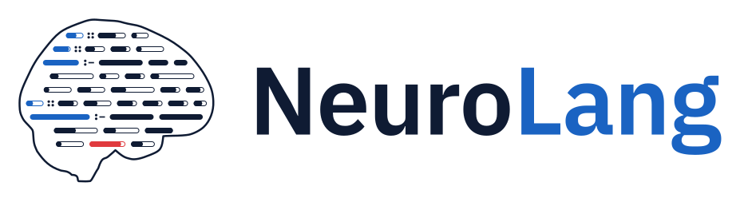

# NeuroLang logo kit

The NeuroLang mark shows the brain written as a probabilistic program. Each line is a rule or a probabilistic fact, and each atom is a track filled to its probability. Rule heads are blue and carry the Datalog neck `:-`. The red atom is the answer to the query, filled to .88.

The brain contour is nilearn's side glass-brain schematic. The lines, their probabilities and the red answer are placed by hand: the mark is schematic, not data.

## Contents

| Folder | What | Use |
|---|---|---|
| `svg/` | `neurolang-mark`, `-lockup` (mark beside the name), `-lockup-stacked`, `-wordmark`, `-mark-small` | Web, print, slides. Text is outlined; no font needed. |
| `png/` | The same at 600, 1200 and 2400 px wide (mark: 256, 512, 1024) | Places that do not take SVG. In the logo kit archive, not in this repository. |
| `favicon/` | `favicon.svg` (switches to its dark twin with the browser theme), `favicon.ico` (16, 32, 48), `apple-touch-icon.png`, `icon-192/512.png`, `icon-512-maskable.png`, `site.webmanifest` | Website and web UI. |
| `social/` | 1280 × 640 card, light and dark | GitHub social preview, Open Graph. |
| `src/` | The scripts that draw everything | Regenerating or tuning. In the logo kit archive, not in this repository. |

Every file exists twice: `x.svg` for light grounds and `x-dark.svg` for dark grounds. Same geometry, only colours differ.

Below 64 px use `neurolang-mark-small`: five fatter lines instead of twelve. `favicon.ico` goes further at 16 px, with three lines.

## Deploying

### Website or web UI

Copy `favicon/` to the site root and add to `<head>`:

```html
<link rel="icon" href="/favicon.ico" sizes="48x48">
<link rel="icon" href="/favicon.svg" type="image/svg+xml">
<link rel="apple-touch-icon" href="/apple-touch-icon.png">
<link rel="manifest" href="/site.webmanifest">
<meta property="og:image" content="https://YOUR-SITE/social/neurolang-social.png">
```

Logo in a page, following the reader's theme:

```html
<picture>
  <source srcset="svg/neurolang-lockup-dark.svg" media="(prefers-color-scheme: dark)">
  
</picture>
```

On a site with its own theme switch (such as the Light / Dark / Computer control), use the `.for-light` / `.for-dark` image pair instead of `<picture>`.

### GitHub repository

- **Social preview:** Settings › General › Social preview › upload `social/neurolang-social.png`.
- **README header, switching with GitHub's theme:**

```markdown
<picture>
  <source media="(prefers-color-scheme: dark)" srcset="docs/logo/neurolang-lockup-dark.svg">
  
</picture>
```

### Sphinx documentation (pydata theme)

```python
html_theme_options = {
    "logo": {
        "image_light": "_static/neurolang-lockup.svg",
        "image_dark": "_static/neurolang-lockup-dark.svg",
    }
}
html_favicon = "_static/favicon.svg"
```

## Colours and type

| Token | Light | Dark |
|---|---|---|
| ink (outline, body atoms, "Neuro") | `#0F1B33` | `#E8EEF9` |
| blue (rule heads, facts, "Lang") | `#1A63C2` | `#5AA3F6` |
| red (the answer, one per mark) | `#E03A3E` | `#FF6B70` |
| muted (tag line) | `#4A5874` | `#A9B8D0` |
| ground | `#FFFFFF` | `#0B1220` |

The wordmark is IBM Plex Sans SemiBold; the tag line is IBM Plex Mono, in capitals.

Clear space: keep at least the height of one code line, a quarter of the mark's height, empty around the mark. Do not recolour the mark, stretch it or put it on a busy image.

## Regenerating

The scripts of `src/` are in the logo kit archive, not in this repository.

```sh
cd src
pip install nilearn fonttools cairosvg pillow svgpathtools
mkdir -p fonts && cd fonts
npm pack @ibm/plex-sans@1.1.0 @ibm/plex-mono@2.5.0
for f in *.tgz; do tar xzf "$f" --one-top-level; done
cd .. && python outline.py && python build_kit.py   # writes ../kit-out/
```

Where to tune:

- `gen3.py`: line layout (`ROWS`, line height `L`, atom height `h`, seed) and probability tracks (`TRACK`).
- `build_kit.py`: the small and 16 px versions (`SMALL`, `TINY`), the lockups and the social card.
- `gen.py`: colour tokens (`TH`).

## To review before publishing

- Tag line on the social card: "Probabilistic logic programming for neuroimaging" (drafted).
- `theme_color` in `site.webmanifest` is set to the dark ground `#0B1220`.
