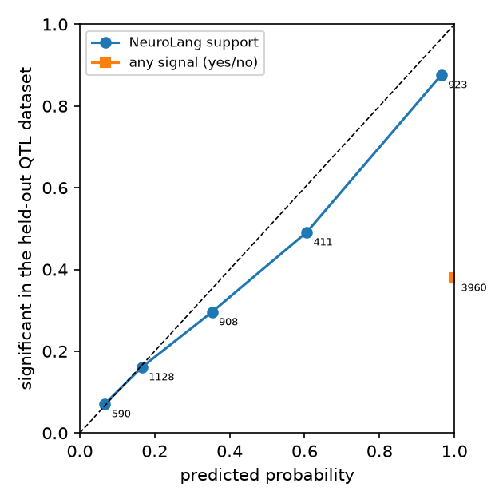

.. _biomedsql-calibration:

Are the probabilities of the ``biomedsql`` engine calibrated?
=============================================================

The ``biomedsql`` engine (BiomedSQL, NIH-CARD) reads Mendelian-randomisation
(SMR) tests of genes as mediators of six neurodegenerative diseases (AD, PD,
ALS, FTD, LBD, PSP), each run with one of 28 QTL datasets: brain and blood
methylation and expression, GTEx tissues, eQTLGen, metaBrain, PsychENCODE.
Each QTL dataset is an equally likely unit of evidence, as a study is in the
meta-analysis engines: ``selected_qtl(q)`` is a uniform choice of one, and the
*support* of a gene ``g`` as a mediator of a disease ``d`` is the probability
that a dataset found it significant given that it tested it::

    support(g, d, PROB) :- (qtl_significant(q, g, d) & selected_qtl(q))
                           // (qtl_tested(q, g, d) & selected_qtl(q))

that is, the share of the datasets that tested ``g`` for ``d`` in which the
test passed BiomedSQL's own threshold, ``p_smr_multi < 2.95e-6``.  This page
checks whether that number can be read as a probability: does a support of
0.3 mean that about 30% of new datasets would find the gene significant?

The experiment
--------------

Leave one QTL dataset out.  For each of the 28 datasets ``h``, the engine
computes the support over the other 27, restricting the choice with a rule of
its own::

    other(q) :- qtl_dataset(q, t, k, o), (q != h)
    support(g, d, PROB) :- (qtl_significant(q, g, d) & selected_qtl(q) & other(q))
                           // (qtl_tested(q, g, d) & selected_qtl(q) & other(q))

Every (gene, disease) pair that ``h`` tested, and that some other dataset
tested, is a prediction, scored against whether ``h`` found it significant:
825,346 predictions, 0.20% of them significant.  The probabilities are
computed by NeuroLang with lifted inference only (no weighted model counting).
As a contrast, the same pairs are scored with the deterministic answer to
BiomedSQL's yes/no question, "is there a significant SMR signal for this
gene?", which is 1 when some other dataset found it significant.

The script is ``tools/biomedsql_calibration.py``::

    uv run --package neurolang-apps python tools/biomedsql_calibration.py \
        --data-dir neurolang_data --out biomedsql_calibration

Results
-------

The 3,960 predictions with a support above 0 (some other dataset found the
gene significant; 38% of them are significant in the held-out dataset):

.. list-table::
   :header-rows: 1

   * - Support
     - Pairs
     - Mean support
     - Significant in the held-out dataset
   * - (0, 0.1]
     - 590
     - 0.067
     - 0.071
   * - (0.1, 0.25]
     - 1,128
     - 0.166
     - 0.161
   * - (0.25, 0.5]
     - 908
     - 0.353
     - 0.296
   * - (0.5, 0.75]
     - 411
     - 0.606
     - 0.491
   * - (0.75, 1]
     - 923
     - 0.965
     - 0.876

   Reliability diagram of the held-out predictions with support above 0;
   the numbers are the pairs in each bin.

.. list-table::
   :header-rows: 1

   * - On the 3,960 pairs with support above 0
     - Expected calibration error [95% interval]
     - Brier score (skill over the base rate)
     - AUC
   * - NeuroLang support
     - 0.048 [0.035, 0.094]
     - 0.145 (+0.39)
     - 0.85
   * - Deterministic yes/no answer
     - 0.620 [0.574, 0.662]
     - 0.620 (−1.63)
     - 0.50

The interval resamples the 28 held-out datasets, whose predictions are
correlated.  Over all 825,346 predictions, the 821,386 pairs of support 0
are significant in the held-out dataset 0.02% of the time; the Brier skill
is +0.55 and the AUC 0.95 (the calibration error, 0.0005, is dominated by
those zeros and says little).

What it shows:

- Below 0.25 the support is calibrated: 0.07 and 0.17 predicted, 0.07 and
  0.16 observed.  Above it the support is overconfident, by 6 to 12 points:
  0.96 predicted, 0.88 observed.
- The deterministic answer says "yes" for all 3,960 pairs, and 38% of them
  are significant in a new dataset: the probability is what separates the
  pairs that replicate (support 0.96, 88%) from those that rarely do (support
  0.07, 7%).
- Supports of exactly 0 and 1 are sometimes wrong: 184 of the 1,688
  held-out positives had support 0, and 66 of the 658 supports of 1 were not
  significant in the held-out dataset, so the log-loss is infinite.  A
  pseudo-count, an imaginary dataset of prior evidence, would remove those.
  The engine has it as ``support_prior`` (two imaginary units of evidence),
  and ``support_graded`` also weighs each test by the strength of its
  p-value; both are evaluated on held-out genes in
  ``tools/biomedsql_benchmark/replication/RESULTS.md``.

Limits
------

- **The units of evidence are not independent.**  Every SMR test of a
  disease uses the same GWAS, and several GTEx tissues come from the same
  donors, so a held-out dataset is not an independent replication; this
  calibration is likely more favourable than a new study would be.
- **Few units.**  A gene is tested in a median of 3 datasets (quartiles 2
  to 7), so supports are coarse fractions.
- **Equal weights.**  Datasets differ in size and power: among pairs with
  support above 0, the share significant in the held-out dataset is 0.30 for
  GTEx whole blood and 0.64 for eQTLGen (0.29 to 0.64 over the 28 datasets),
  while the mean supports predicted for them are close (0.44 and 0.46).  A
  choice weighted by power is not tested.
- **"Not tested" is not "negative".**  The support's denominator is the
  datasets that tested the gene; a gene a dataset did not measure does not
  count against it.  A test is significant when any probe of the gene is.
