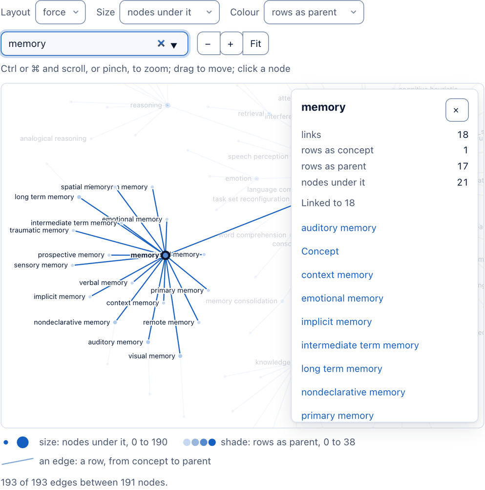
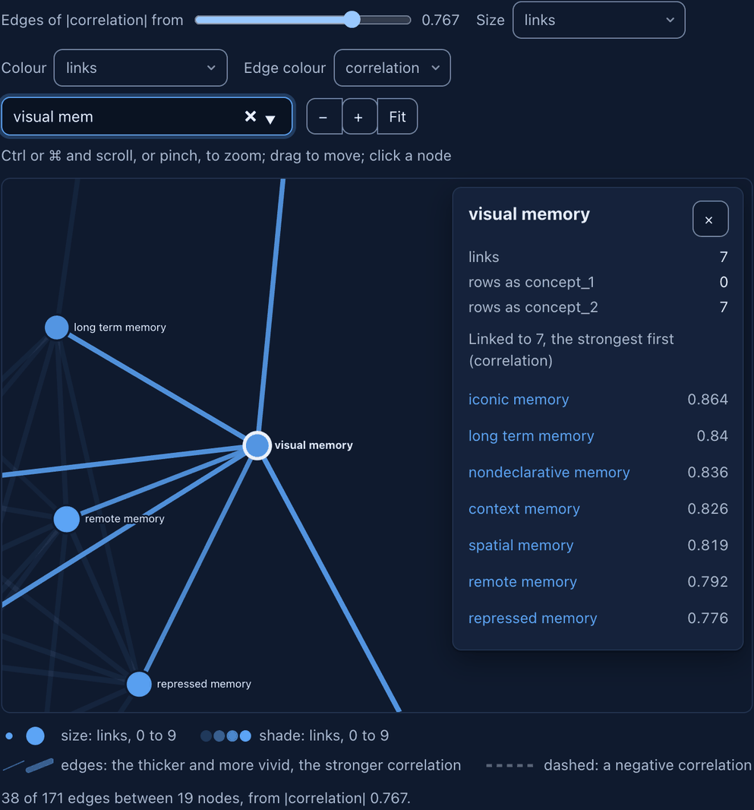

.. _neurolang-repl:

Using the REPL
==============

NeuroLang is used by typing queries into a REPL: a prompt that runs each
statement as it is entered and shows its result. The same REPL runs in two
places:

* **in the browser**, at `the REPL page <_static/repl/index.html>`_, with
  nothing to install;
* **in a terminal**, as ``neurolang-query -i``, with all the engines and
  their precomputed analyses, files on your disk, and scripts.

Both take the same statements and the same dot-commands, so every example of
this documentation runs in either. Under each one, *Run in the browser REPL*
opens the page with the example in its box; press **Run**, or type it in a
terminal.

.. contents:: On this page
   :local:
   :depth: 1

Starting it
-----------

.. tab-set::

   .. tab-item:: In the browser

      Open `the REPL page <_static/repl/index.html>`_. The first start takes
      about 30 s: the browser loads Python, NeuroLang and the engine's data,
      and keeps them for the next visit. The selector at the top of the page
      chooses the engine; the address can name it too, as
      ``index.html?engine=neurosynth``.

      The engine of the page leaves out the precomputed analyses (``lift``,
      ``relative_risk``, ``uniformity``, ``ratios``): they need several GB,
      more than a browser tab is given. ``?engine=full`` builds them on a
      machine with the memory.

   .. tab-item:: In a terminal

      Install the applications (see :doc:`install`), then start the REPL
      on an engine:

      .. code-block:: bash

         pip install "neurolang[apps]"
         neurolang-query -i --engine neurosynth

      The first start downloads the engine's data into ``neurolang_data``
      (``--data-dir`` puts it elsewhere) and takes a few minutes; later
      starts build the engine from it, in well under a minute. ``neurolang-query --list-engines`` lists the
      engines; ``--resolution 2`` builds the voxel relations at 2 mm.

The REPL greets you with the engine's relations and an example to try:

.. nl-repl::

   ans(s) :- mentions(s, "pain")

.. code-block:: text

   ╭──────────╮
   │ s        │
   ├──────────┤
   │  9862924 │
   │ 10601675 │
   │ …        │
   ╰──────────╯
   516 rows · showing 1–20 · .more for next
   Query completed in 1.30 s

The answer is a table: here the PubMed ids of the 516 studies of Neurosynth
that mention pain. In the browser, the table can be sorted, filtered,
plotted and downloaded.

Statements
----------

A statement is a rule, a fact, a query or a dot-command. A rule defines a
relation; a query, whose head is ``ans``, asks for one:

.. nl-repl::

   pain_study(s) :- mentions(s, "pain")
   ans(s) :- pain_study(s) & mentions(s, "memory")

A ``%`` starts a comment, to the end of the line. :doc:`tutorial` introduces
the rules, and :doc:`tutorial_datalog` the whole language; ``.mode squall``
switches to SQUALL, controlled English (:doc:`tutorial_squall`).

.. tab-set::

   .. tab-item:: In the browser

      The box takes as many statements as you like, on as many lines; **Run**
      (or Ctrl+Enter) runs them in order.

   .. tab-item:: In a terminal

      Enter runs a statement. One left unfinished (an open bracket, a
      trailing ``,`` or ``:-``) continues on the next line, and an empty
      line runs it; Alt+Enter inserts a newline. Tab completes commands,
      relations and their columns; the arrows and Ctrl+R go through the
      history.

The session
-----------

The rules you define stay for the rest of the session, so that a query can
use the rules of earlier statements. One exception: rules that come in the
same submission as a query (in the browser, in the same box; in a terminal,
in the same file) belong to that query and are discarded after it, so that
the next query can define rules of the same names. ``.scope off`` keeps them
too.

.. list-table::
   :header-rows: 1
   :widths: 25 75

   * - Command
     - What it does
   * - ``.idb [PREDICATE]``
     - lists the relations defined in the session, or the numbered rules of
       one
   * - ``.drop PREDICATE [N]``
     - removes rule ``N`` of a relation, all its rules, or a loaded relation
   * - ``.clear [PREDICATE]``
     - clears what the session defined, or one relation
   * - ``.scope [on|off]``
     - keeps the rules of a query local to it (on, the default), or in the
       session

In the browser, **Save session** writes the session's rules to a file and
**Open session** defines them again; facts typed in the session are not in
it.

The engine's data
-----------------

An engine is a set of relations built from a dataset: the studies of
Neurosynth with the terms they mention and the peaks they report, brain
atlases, an ontology. ``.predicates`` lists them with their columns, and
``.sets`` the stored ones; in the browser, *Examples and relations* lists
them too, each with its documentation. :doc:`engine_configuration` describes
the engines and how to make one.

Your own data
.............

Facts are typed as statements without a body:

.. nl-repl::

   liked("pain")
   liked("memory")
   ans(t) :- liked(t)

In a terminal, ``.load PATH [NAME]`` reads a CSV or TSV file (optionally
gzipped) into a relation whose columns are the file's header:

.. code-block:: text

   nl(neurosynth:DL)> .load my_terms.csv my_terms
   loaded my_terms(term, group): 2 rows from my_terms.csv

On the page, **Upload data** sends a CSV or TSV file of yours (at most
50 MB) to the session and loads it, with ``.load NAME``; ``.load NAME``
loads it again later, under another relation name if given.  The page in
the browser keeps the file in the memory of the session; a server
(``neurolang-repl-serve``) keeps it in a folder of the session, removed
when the session ends, stopped or unused for a while (its limits and its
folder are its options, see :doc:`repl_server`).  The page sends the file
again when it gives the session's rules back (after **Stop**, or when a
saved session is opened), and forgets it on **Restart**.  A server loads
the files you upload, and no path of its own.  ``.uploads`` lists the files
of the session, what each was loaded as, and the room left; the page lists
them under its toolbar, with a *Download* and a *Remove* for each: *Remove*
(``.uploads remove NAME``) deletes one from the session, and from what the
page uploads again, leaving the output as it was; its *Undo* (``.uploads
restore NAME``) brings it back, until another file is uploaded or removed.
The relations loaded from a removed file stay until ``.drop`` or
**Restart**.

The query assistant reads, with the relations and their columns, their
descriptions: describe yours, so that it finds them and knows what they
hold.  ``.document`` describes a relation loaded or defined in the
session, a ``%%`` line right before a rule describes it (see
:doc:`tutorial_datalog`), and ``.image`` describes the image it loads
(its file, a mask or a map of values)::

   .load 'my scores.csv' scores
   .document(scores, "The scores of the studies of my lab: study is a PubMed id, score from 0 to 1.")
   %% The studies of my lab with a high score.
   high(s) :- scores(s, x), (x > 0.4)

The page keeps the descriptions with the rules of the session, after
**Stop** or in a saved session.

**Upload data** also takes a NIfTI image of activations (``.nii`` or
``.nii.gz``), a binary mask or a z-map, and a tractogram (``.trk`` or
``.tck``), decoded where its streamlines end: the page loads it with
``.image``, shows it, and asks whether the query decoding it towards the
terms of the studies, a comment explaining each line, goes in the box and
runs (:doc:`tutorial_decoding`).

Results
-------

.. list-table::
   :header-rows: 1
   :widths: 30 70

   * - Command
     - What it does
   * - ``.sort [COL[:asc|desc] ...|none]``
     - sorts the results, e.g. ``.sort n:desc``
   * - ``.head [N]``, ``.more``, ``.all``
     - sets the page size, shows the next page, or every row
   * - ``.format [table|csv|json]``
     - prints the results as a table, CSV or JSON
   * - ``.save PATH``
     - saves the last result as CSV or TSV, or as a NIfTI image for a
       ``.nii`` or ``.nii.gz`` path (``.help save``)
   * - ``.view``
     - shows the last result, or a NIfTI file, in a brain viewer
       (``.help view``)
   * - ``.graph``
     - shows where the answer of the last query comes from: its data, rules
       and probabilities, as a graph

In the browser, the result is a table to sort, filter and download (CSV,
TSV, or NIfTI for voxels), with tabs for the brain viewer and the graph.
Its *Plot* button draws the rows the filter keeps: bars of a column (a
probability by region, the most probable in red) or of how many rows each
value has, a histogram of a numeric column, or two numeric columns as
points or a line; the values of a mark show under the pointer.
An answer whose rows are edges, two columns of the same sort and a
weight (``ans(concept_1, concept_2, correlation)``), also shows in the
*Network* tab: its nodes and edges, the stronger an edge the thicker
(dashed if negative), from the weight its slider sets; it starts with
the strongest edges, two per node. Its controls size and shade the nodes
by their links, their rows in each column (the children of a parent, in
``ans(concept, parent)``) or, of a hierarchy, the nodes under each, and
shade the edges by their weight; a hierarchy (an edge per node, and a
root) can be drawn as a radial tree, as it is at first if small.

The network zooms with Ctrl or ⌘ and the wheel, a pinch or its buttons
(*Fit* shows it whole) and moves with a drag; the farther, the fewer
names, those of the most linked nodes. A node found by name in the box
above it, or clicked, is focused: it and its neighbours stand out, the
others fade, and a panel lists its measures and its neighbours, the
strongest first, each a button to go to it; Escape, or a click beside
the nodes, ends the focus.

         root, Concept, with memory focused: its 18 neighbours stand out
         and the panel on the right lists them.

         correlation of their activations, visual memory focused, its
         neighbours listed with their correlations, the strongest first.

The query assistant
-------------------

``.ask QUESTION`` writes a query answering a question in English with a
large language model, and ``.explain`` reads the last query in English; see
:doc:`query_assistant`. In the browser, the box above the code takes the
question, with your own API key; *Past questions*, under it, keeps each
question with the query it gave, to put that query back in the box or ask
the question again.

Scripts and transcripts
-----------------------

A terminal session can start from a file of statements, or be one:

.. code-block:: bash

   neurolang-query -i --engine neurosynth --file rules.dl   # then the prompt
   neurolang-query -i --engine neurosynth < session.dl      # runs it and exits

The second form runs the file statement by statement, as if typed, and exits
with status 1 if one failed. ``.transcript PATH`` writes the session as
Markdown, or, with ``--inputs``, as such a file. A single query can also run
without the REPL: see :ref:`appendix-b-datalog`.

Every command
-------------

``.help`` lists them in the REPL, and ``.help TOPIC`` tells more about
``save``, ``view``, ``feedback`` and ``squall``.

.. list-table::
   :header-rows: 1
   :widths: 30 55 15

   * - Command
     - What it does
     - Where
   * - ``.help [squall|TOPIC]``
     - this help, a primer on SQUALL, or help on a topic
     - both
   * - ``.mode datalog|squall|vi|emacs``
     - the query language, or the editing keys of the terminal
     - both
   * - ``.sort``, ``.more``, ``.head``, ``.all``, ``.format``
     - how the results are shown (see `Results`_)
     - both
   * - ``.save PATH``
     - the last result in a file (see `Results`_)
     - terminal; the browser has its download menu
   * - ``.view``, ``.graph``
     - the last result in the brain viewer, or as a graph (see `Results`_)
     - both
   * - ``.idb``, ``.drop``, ``.clear``, ``.scope``
     - the session's rules (see `The session`_)
     - both
   * - ``.load PATH|UPLOADED [NAME]``
     - a CSV or TSV file as a relation: a path in a terminal, a file
       uploaded (**Upload data**) on the page
     - both
   * - ``.image PATH|UPLOADED [--mask | --zscore] [--cortex] [--radius MM]``
     - a NIfTI image of activations, shown and decoded as a mask
       (``--mask``) or from z-scores (``--zscore``), in the brain or in
       the cortex only (``--cortex``); a tractogram (``.trk``, ``.tck``),
       as the voxels within 3 mm (``--radius``) of the ends of its
       streamlines (see :doc:`tutorial_decoding`)
     - both
   * - ``.uploads [remove NAME | restore NAME]``
     - the files the page uploaded in the session: their kind, size, age,
       the relations loaded from them, and the room left; ``remove NAME``
       deletes one (the relations loaded from it stay, until ``.drop``),
       ``restore NAME`` brings back the one removed last
     - both
   * - ``.sets``, ``.predicates``, ``.engines``
     - the engine's relations, and the engines
     - both
   * - ``.credits``
     - the sources of the engine's data, and how to acknowledge them; on
       the page, **Credits** lists them for each of its engines
     - both
   * - ``.datalog [PREDICATE]``
     - the Datalog of the last SQUALL query, or the rules of a relation
     - both
   * - ``.rewritten [on|off]``, ``.ra [on|off]``
     - the program as rewritten for the solver, and its relational algebra
       plans (see :ref:`appendix-b-datalog`)
     - both
   * - ``.ask``, ``.explain``, ``.llm``, ``.rate``, ``.refine``
     - the query assistant (see :doc:`query_assistant`)
     - both
   * - ``.transcript PATH``
     - the session as Markdown or as a script
     - terminal
   * - ``.import("m.dl")``
     - a Datalog module, once
     - both
   * - ``.name(...)``
     - any other: a command of the engine, as ``.load_csv(name, "url")``
     - both
   * - ``.quit``, ``.exit``
     - leaves the REPL (also Ctrl+D)
     - terminal
