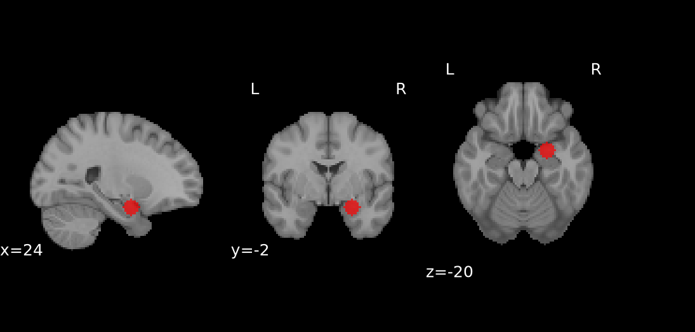
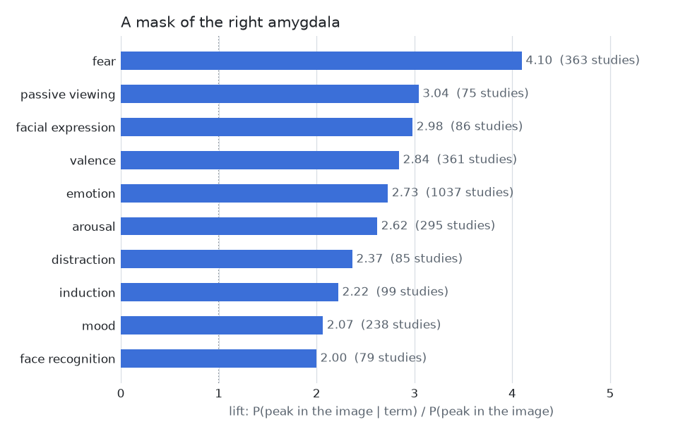
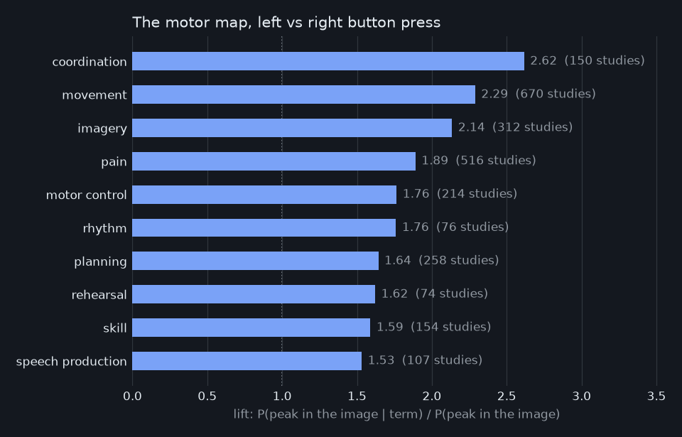

Decoding a brain image
======================

A map of activations, the result of an experiment of yours, says *where*
the brain responds.  Decoding asks the reverse question: which mental
processes do the studies that activate the same places study?  NeuroLang
decodes an image towards the terms of a meta-analysis engine, Neurosynth's
or NeuroStore's, with the probabilistic model those engines already use
for their maps (:doc:`tutorial_neurosynth_tests`): this page loads an
image, explains the model, and decodes two images, a mask of the amygdala
and a statistical map of a motor task.

Loading an image
----------------

In the REPL in a terminal, ``.image`` loads a NIfTI image, gzipped or not:

.. code-block:: text

    nl(neurosynth:datalog)> .image doc/_static/decoding/amygdala_mask.nii.gz

In the browser, and on a server, *Upload data* (under *More*) takes the
``.nii`` or ``.nii.gz`` file: the page keeps it in the memory of the
session, runs ``.image`` on it, and puts the query decoding it in the
box.  A server reads none of its own files for its users, so an image
must be uploaded there.  The engine of the page in the browser leaves
out the peaks of the studies' activations (``activated``) to fit in a
tab: it loads and shows the image, and decodes it with ``?engine=full``
added to the address.

``.image`` resamples the image to the grid of the engine, if it has
another, and keeps its first volume if it has several.  It defines

``image(i, j, k, value)``
    the voxels of the brain where the image is not 0, with their value;

``image_voxel(i, j, k, weight)``
    the *activated* voxels, with the probability ``weight`` to choose each
    among them (the weights add up to 1);

``image_decoding(t, lift, studies)``
    the decoding of the image, explained below,

and shows the image in the brain viewer.  ``--name NAME`` names the
relations ``NAME``, ``NAME_voxel`` and ``NAME_decoding`` instead, to load
several images, or to replace one: ``.image PATH --name image`` loads
another image in place of the first, and the decoding is that of the new
one.

The activated voxels depend on what the image is:

A binary mask
    (one value other than 0, such as a region of interest) — all its voxels,
    equally likely.  A mask on another grid is resampled to the nearest
    voxel, so it stays a mask.

A z-map
    (any other image) — its voxels of a value of at least 3.1, the
    threshold of a one-sided p < 0.001, each the more likely the larger its
    value: a voxel of z = 6 is chosen twice as often as one of z = 3.
    ``--threshold`` sets another value, or a percentile of the values
    (``--threshold 95%``).  The negative values, deactivations, are never
    chosen.

The defaults, the threshold and the largest image taken (256 MB
uncompressed), are under ``image`` in the ``viewer.yaml`` of
``neurolang_apps.utils.tui``.

The model
---------

The meta-analysis engines choose a study at random,
``selected_study(s)``, and say that it activates the voxel :math:`v`,
:math:`A_v`, if one of its peaks is within 6 mm of it.  A term :math:`T`
holds when the study mentions it (``term_in_study``).  ``.image`` adds a
second choice, that of a voxel :math:`V` of the image, independent of the
study, with the probability :math:`w_v` above (equal over a mask, in
proportion to :math:`z` over a z-map).  The event :math:`A_V`, that the
chosen study activates the chosen voxel, has the probability

.. math::

    P(A_V) = \sum_v w_v \, P(A_v),
    \qquad
    P(A_V \mid T) = \sum_v w_v \, P(A_v \mid T),

the activation of the image averaged over its voxels, by all the studies
and by those of the term.  The *lift* of the term is their ratio,

.. math::

    \mathrm{lift}(T) = \frac{P(A_V \mid T)}{P(A_V)}:

the studies of :math:`T` activate the image ``lift`` times as often as
the average study.  A lift above 1 associates the term with the image;
the terms of the largest lifts decode it.  It is the ``uniformity`` of
:doc:`tutorial_neurosynth_tests` with the voxels of the image in place of
those of the whole brain, ``selected_voxel``.

The engine's ``image_decoding`` (in ``engines.yaml``) writes it in
Datalog, ``{name}`` being the name of the image:

.. literalinclude:: ../packages/neurolang_apps/neurolang_apps/utils/engines/engines.yaml
   :language: text
   :start-after: rules: |
   :end-before: query: "ans(term
   :dedent: 8

The voxel is chosen independently of the study, so that a study
:math:`s` activates the chosen voxel with the probability

.. math::

    P(A_V \mid s) = \sum_{v \,:\, A_v(s)} w_v,

the weight of the voxels of the image it activates: ``image_score``.  The
rules make it a probabilistic fact of each study, ``image_hit(s)``, and
condition it on the studies of each term, ``image_given_term``, which is
:math:`P(A_V \mid T)` for every term at once; ``image_activated`` is
:math:`P(A_V)`, and ``image_term_studies`` the number of studies of each
term.  Writing the choice of the voxel as a second probabilistic choice
beside that of the study gives the same probabilities, but the engine
then pairs every activated voxel of the image with every term of the
study before summing: the motor map below took 96 s on the neurosynth
engine, instead of 5 to 8, and more than 34 GB on the neurostore engine.  A
term none of whose studies activates the image has a probability of 0,
and is no answer.

The lift of a term of few studies is noisy: one study of a rare term
activating the image makes it large.  The query ``.image`` offers keeps
the terms of 30 studies or more, and those that are concepts of the
Cognitive Atlas (:doc:`tutorial_cognitive_atlas`), rather than every
word of the abstracts:

.. code-block:: text

    ans(term, lift, studies) :- image_decoding(term, lift, studies),
        cogat_term(concept, term), (studies >= 30)

Drop ``cogat_term`` to rank every term of the engine, and ask for one term
with a constant: ``ans(lift, studies) :- image_decoding('fear', lift,
studies)``.

A mask: the amygdala
--------------------

``amygdala_mask.nii.gz`` (:download:`download
<_static/decoding/amygdala_mask.nii.gz>`) is a sphere of 8 mm around the
right amygdala, at (24, -2, -20) mm in MNI space, on the grid of 2 mm:

.. code-block:: text

    nl(neurosynth:datalog)> .image doc/_static/decoding/amygdala_mask.nii.gz
    loaded image(i, j, k, value): 257 voxels from doc/_static/decoding/amygdala_mask.nii.gz;
    image_voxel(i, j, k, weight): the 257 voxels of the mask, equally likely
    Decode it: ans(term, lift, studies) :- image_decoding(term, lift, studies),
        cogat_term(concept, term), (studies >= 30)

    nl(neurosynth:datalog)> ans(term, lift, studies) :- image_decoding(term, lift, studies),
        cogat_term(concept, term), (studies >= 30)

The 118 concepts of the Cognitive Atlas among the terms of Neurosynth with
30 studies or more get a lift; the largest ten are those of emotion and
faces.  The studies of *fear* activate the right amygdala four times as
often as the average study:

.. image:: _static/decoding/amygdala_decoding_dark.png
   :class: only-dark
   :alt: The ten concepts of the largest lift for the amygdala

A statistical map: pressing a button
------------------------------------

The statistical map of pressing a button with the left hand against the
right, NeuroVault's `image 10426 <https://neurovault.org/images/10426/>`_,
is the sample motor activation image of nilearn, on a grid of 3 mm, with
values from -7.9 to 7.9; in Python,
``nilearn.datasets.load_sample_motor_activation_image()`` downloads it and
returns its path.  Its positive values are the right motor cortex, which
moves the left hand; ``.image`` resamples it to the grid of 2 mm of the
engine, and takes its voxels of 3.1 or more, as of a z-map:

.. image:: _static/decoding/motor_image.png
   :alt: The motor map, thresholded at 3.1, on the MNI template

.. code-block:: text

    nl(neurosynth:datalog)> .image image_10426.nii.gz --name image
    loaded image(i, j, k, value): 179612 voxels from image_10426.nii.gz;
    image_voxel(i, j, k, weight): the 8219 voxels with a value of 3.1 or more,
    the more likely the larger their value

and the same query decodes it towards movement: *coordination*,
*movement*, *imagery* (motor imagery activates the premotor cortex) and
*motor control*.  *Pain* is among them because the map also covers the
somatosensory cortex behind the motor one, and the parietal operculum
(the second cluster at x = 38), which the studies of pain activate:

.. image:: _static/decoding/motor_decoding_light.png
   :class: only-light
   :alt: The ten concepts of the largest lift for the motor map

What the decoding does not say
------------------------------

The lift ranks the terms by how often their studies activate the image;
it is no test.  Whether a lift is larger than chance, or than that of
another term, is the question of :doc:`tutorial_neurosynth_tests`: the
bootstrap of the studies (``RESAMPLE[boot_studies]``) gives an interval
for the lift of one term, that of *fear* for the amygdala, say:

.. code-block:: text

    lift_replicate(b, x) :- RESAMPLE[boot_studies](image_decoding('fear', x, n)) = b
    interval(lift, percentile(x, 2.5), percentile(x, 97.5)) :-
        image_decoding('fear', lift, n), lift_replicate(b, x)
    ans(lift, ci_low, ci_high) :- interval(lift, ci_low, ci_high)

gives 4.10 within [3.47, 4.64], in about 10 s: the replicates of the studies
never bring it near 1.  Two terms are compared on the same replicate
``b``, as in :doc:`tutorial_neurosynth_tests`.

On the neurosynth engine at 2 mm, each image is decoded in 5 to 8 s,
the 257 voxels of the amygdala as the 8,219 of the motor map; on the
neurostore engine, of twice as many studies, in about 25 s, with less
than 1 GB of memory beyond that of the engine.

The figures of this page are made by ``doc/tools/make_decoding_figures.py``
on the neurosynth engine at 2 mm, which loads both images with ``.image``
and runs the query above.
