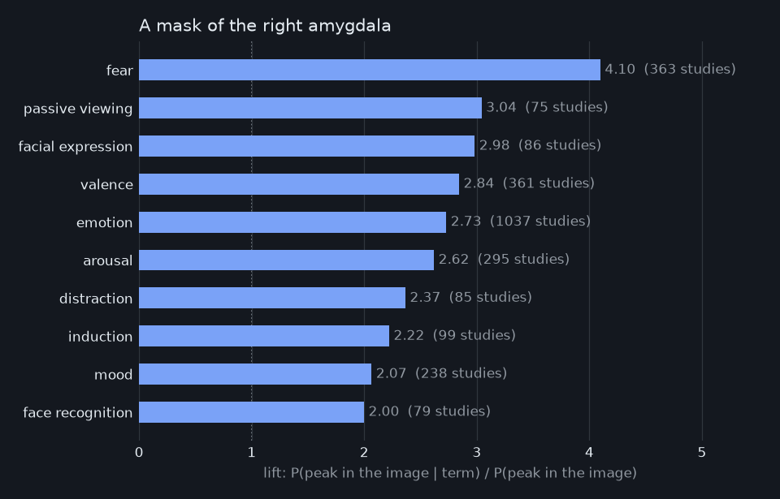
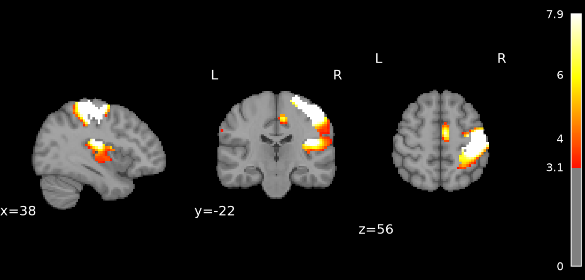
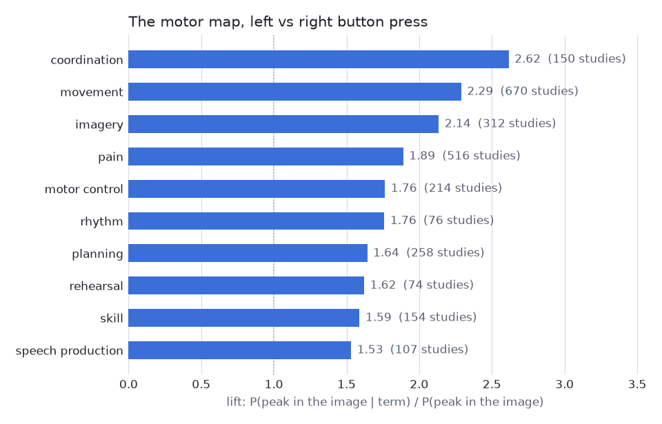

Decoding a brain image
======================

A map of activations, the result of an experiment of yours, says *where*
the brain responds.  Decoding asks the reverse question: which mental
processes do the studies that activate the same places study?  NeuroLang
decodes an image towards the terms of a meta-analysis engine, Neurosynth's
or NeuroStore's, with the probabilistic model those engines already use
for their maps (:doc:`tutorial_neurosynth_tests`), in a query of plain
Datalog over the image as a relation of voxels and values.  This page
loads an image, explains the query, and decodes two images, a mask of the
amygdala and a statistical map of a motor task, and three bundles of white
matter by the ends of their streamlines.

Loading an image
----------------

In the REPL in a terminal, ``.image`` loads a NIfTI image, gzipped or not:

.. code-block:: text

    nl(neurosynth:datalog)> .image doc/_static/decoding/amygdala_mask.nii.gz

as a relation named after its file, ``amygdala_mask(i, j, k, value)`` here
(``--name`` gives another): the voxels of the brain where the image is not
0, with their value, on the grid of the engine.  The image
is resampled to that grid if it has another, a mask (an image of one value
other than 0) to the nearest voxel so that it stays a mask, and its first
volume is kept if it has several.  It loads, too,
``amygdala_mask_probability(i, j, k, p)``, the probability that each voxel is
active, which the decoding weighs the voxels by (see `The score: the lift
of a term`_).  Two decodings are offered:

``--mask``, masked decoding
    1 for each voxel of a binary mask, which needs no flag, or of a map of
    values from 3.1 (``image.threshold``): its voxels weigh the same.

``--zscore``, from z-scores
    for a map of z-scores, the probability that the z-score of each voxel
    is that of an active voxel: its voxels weigh their probability.

A map loaded without either has none, and is not decoded until it is
loaded again with one.
``.image`` shows the image in the brain viewer, and prints the query
decoding it.  ``--name NAME`` names the relations ``NAME`` and
``NAME_probability`` instead, to load several images; ``.image PATH --name
image`` replaces the image loaded first.

In the browser, and on a server, *Upload data* (in the toolbar) takes the
``.nii`` or ``.nii.gz`` file: the page keeps it with the session, runs
``.image`` on it, and asks whether to decode it (*Run the decoding query*,
or *Not now*): the decoding query, a comment explaining each of its lines,
goes in the box and runs.  It replaces what is there, which *Bring back
the query before* puts back until the next run.  For a map of values, the
page offers the two decodings, *Decode as z-scores* and *Decode as a mask
(from 3.1)*, loads it again with ``--zscore`` or ``--mask``, then runs the
query.  *Only the cortex*, checked,
decodes the cortex of the image alone (``--cortex``, below).  A
server reads none of its own files for its users, so an image must be
uploaded there.  The engine of the page in the browser leaves out the peaks
of the studies' activations (``activated``) to fit in a tab: it loads and
shows the image, and decodes it with ``?engine=full`` added to the address.

The largest image taken, 256 MB uncompressed, is ``image.max_mb`` in the
``viewer.yaml`` of ``neurolang_apps.utils.tui``.

The score: the lift of a term
-----------------------------

The meta-analysis engines choose a study at random, ``selected_study(s)``,
and say that it activates the voxel :math:`v`, :math:`A_v`, if one of its
peaks is within 6 mm of it.  A term :math:`T` holds when the study mentions
it (``term_in_study``).  Decoding chooses, besides, a voxel :math:`V` of the
image, independently of the study, the more likely the more probably
active: of the probability :math:`p_v` that the voxel :math:`v` is active,

.. math::

    P(V = v) = \frac{p_v}{\sum_u p_u}.

Every voxel of a mask is active, :math:`p_v = 1`, and equally likely.  A
voxel of a map of z-scores is active, or of the null, its z-score drawn
from the one or the other distribution; the probability that it is active
is 1 minus its *local false discovery rate* (Efron 2004),

.. math::

    p_v = 1 - \frac{\pi_0 \, f_0(z_v)}{f(z_v)},

:math:`f` the density of the z-scores of the map, a Gaussian kernel
estimate, :math:`f_0` that of the null, the normal of the median and the
median absolute deviation of the map (its *empirical* null, which the
smoothness of a map makes wider or narrower than :math:`N(0, 1)`), and
:math:`\pi_0 = 1`, the share of null voxels at its most.  A z-score below
the median, a deactivation, is never active, nor are the voxels of a
probability below 0.01 kept (``image.min_probability`` in
``viewer.yaml``).  On the motor map below, z = 2 gives p = 0.16, z = 3 gives
0.92 and z = 4 or more 1: no threshold is chosen, the map says where its
activations start.

The event :math:`A_V`, that the chosen study activates the chosen voxel,
has the probability

.. math::

    P(A_V) = \sum_v P(V = v) \, P(A_v),
    \qquad
    P(A_V \mid T) = \sum_v P(V = v) \, P(A_v \mid T),

the activation of the image averaged over its voxels, by all the studies
and by those of the term.  The *lift* of the term, the score of the
decoding, is their ratio,

.. math::

    \mathrm{lift}(T) = \frac{P(A_V \mid T)}{P(A_V)}:

the studies of :math:`T` activate the image ``lift`` times as often as the
average study.  A lift above 1 associates the term with the image; the
terms of the largest lifts decode it.  It is the ``uniformity`` of
:doc:`tutorial_neurosynth_tests` with the voxels of the image, weighted,
in place of those of the whole brain.

The query: the voxels as facts, one of them chosen
--------------------------------------------------

The decoding query of the engines (``image_decoding_query`` in
``engines.yaml``, ``{image}`` being the name of the image and ``{voxel}``
the voxels chosen, ``selected_voxel(i, j, k)`` of its
``image_decoding_voxels``) says this as a
probabilistic program: each voxel of the image is a fact, active with its
probability, a voxel of the brain is chosen uniformly, the engine's
``selected_voxel`` (that of ``uniformity``, :doc:`tutorial_neurosynth_tests`),
and a study hits the image when it activates the chosen voxel and that
voxel is active:

.. literalinclude:: ../packages/neurolang_apps/neurolang_apps/utils/engines/engines.yaml
   :language: text
   :start-after: image_decoding_query: |-
   :end-before: # The Cognitive Atlas ontology
   :dedent: 6

- ``image_active(i, j, k)`` is a probabilistic fact of each voxel, of its
  probability :math:`p_v`; ``selected_voxel(i, j, k)`` a choice of one of
  the :math:`N` voxels of the brain mask, each of probability :math:`1/N`;
- ``image_hit(s)`` holds when the study ``s`` activates the chosen voxel,
  which is active;
- ``p_image_given_term(t, p)`` conditions it on the studies of each term,
  for every term at once, and ``p_image(q)`` is its probability over all
  the studies;
- the answer keeps the terms of 30 studies or more, the engine's
  ``term_studies(t, n)`` (the number of studies of each term, solved
  when the engine is built: its ``materialised``), since one study of a
  rare term activating the image makes its lift
  large, and the concepts of the Cognitive Atlas
  (:doc:`tutorial_cognitive_atlas`) rather than every word of the
  abstracts.  Drop ``cogat_term`` to rank every term of the engine.

The voxel is chosen independently of the study, and the facts of the
voxels are independent of it too, so that

.. math::

    P(\mathrm{hit} \mid s) = \frac{1}{N} \sum_{v \,:\, A_v(s)} p_v,

the voxels of the image outside the brain mask, which no study activates
(``activated`` is in the mask), adding nothing; averaged over the studies
of :math:`T`, or over all of them, :math:`\frac{1}{N} \sum_v p_v P(A_v
\mid T)` and :math:`\frac{1}{N} \sum_v p_v P(A_v)`.  These are
:math:`P(A_V \mid T)` and :math:`P(A_V)` above times the same constant
:math:`\sum_u p_u / N`, so their ratio, ``lift``, is the lift of the term:
the voxel chosen in the image alone, uniformly
(``image_voxel(i, j, k) ^ q :- image_probability(i, j, k, p),
image_size(n), (q == 1.0 / n)``), gives the same lifts.

Choosing the voxel in the cortex instead decodes the cortical part of the
image only, its subcortical and cerebellar voxels left out (``.image
--cortex``, the page's *Only the cortex*, ``{voxel}`` being then
``selected_voxel(i, j, k), cortical_mask(i, j, k)``):

.. code-block:: text

    image_hit(s) :- selected_voxel(i, j, k), cortical_mask(i, j, k), image_active(i, j, k), activated(i, j, k, s)

``cortical_mask`` being the voxels of the Harvard–Oxford cortical atlas.
For the motor map below the lifts move by 0.08 at most (*planning* enters
the first six); a map with subcortical activations changes more.

The engine solves the program exactly (:doc:`probabilistic_lifting`): the
choice of the voxel makes the probability a sum over the voxels, which it
computes for each study, the image joined with ``activated`` first, before
the terms of the studies.  It is the weighted query one would write by
hand,

.. code-block:: text

    image_score(s, sum(p)) :- image_probability(i, j, k, p), activated(i, j, k, s)
    image_total(sum(p)) :- image_probability(i, j, k, p)
    image_hit(s) :: q :- image_score(s, x), image_total(y), (q == x / y)

of the same lifts, for the motor map below 13 s and 6 GB where this one
takes 7 s and 5 GB.

The query reads the image as any relation of voxels and probabilities: a
map of yours loaded with ``.load``, ``my_map_probability(i, j, k, p)``, is
decoded by the same query with ``my_map`` in place of ``image``.  A term
none of whose studies activates the image has a probability of 0, and is
no answer.

The same lift is :math:`\sum_v p_v P(A_v \mid T) / \sum_v p_v P(A_v)`,
the image joined with the engine's ``p_a_given_t(t, i, j, k, p)`` and
``p_a(i, j, k, p)``; but the engine computes those for every term at every
voxel before the join, more than 40 GB for the amygdala below, where the
query above reads only the studies.

The overlap: the voxels as facts, none chosen
---------------------------------------------

Without the choice of a voxel, a study hits the image if it activates
any active voxel of it,

.. math::

    P(\mathrm{hit} \mid s) = 1 - \prod_{v \,:\, A_v(s)} (1 - p_v),

which NeuroLang writes as it is said:

.. code-block:: text

    image_active(i, j, k) :: p :- image_probability(i, j, k, p)
    image_hit(s) :- activated(i, j, k, s), image_active(i, j, k)

the rest of the program as above.  For a mask or a small region, it is how
much more often the studies of a term report a peak in it: fear 2.92,
valence 2.50, emotion 2.32 for the amygdala below.  On a whole map, nearly
every study activates some active voxel of it, 98% of them for the motor
map, and the lifts of all the terms are near 1: the choice of a voxel
above tells them apart.

A mask: the amygdala
--------------------

``amygdala_mask.nii.gz`` (:download:`download
<_static/decoding/amygdala_mask.nii.gz>`) is a sphere of 8 mm around the
right amygdala, at (24, -2, -20) mm in MNI space, on the grid of 2 mm:

.. image:: _static/decoding/amygdala_image.png
   :alt: The mask of the right amygdala on the MNI template

.. code-block:: text

    nl(neurosynth:datalog)> .image doc/_static/decoding/amygdala_mask.nii.gz
    loaded amygdala_mask(i, j, k, value): 257 voxels from
    doc/_static/decoding/amygdala_mask.nii.gz, a mask
    loaded amygdala_mask_probability(i, j, k, p): 257 voxels, the probability
    that each is active: 1 for each voxel of the mask
    Decode it with this query:
    % Each voxel of the image is active with its
    ...

The 118 concepts of the Cognitive Atlas among the terms of Neurosynth with
30 studies or more get a lift; the largest ten are those of emotion and
faces.  The studies of *fear* activate the right amygdala four times as
often as the average study:

.. image:: _static/decoding/amygdala_decoding_light.png
   :class: only-light
   :alt: The ten concepts of the largest lift for the amygdala

A statistical map: pressing a button
------------------------------------

The statistical map of pressing a button with the left hand against the
right, NeuroVault's `image 10426 <https://neurovault.org/images/10426/>`_,
is the sample motor activation image of nilearn, on a grid of 3 mm, with
values from -7.9 to 7.9; in Python,
``nilearn.datasets.load_sample_motor_activation_image()`` downloads it and
returns its path.  Its positive values are the right motor cortex, which
moves the left hand.  ``.image`` resamples it to the grid of 2 mm of the
engine and, with ``--zscore``, gives each voxel the probability that it is
active: 38,141 voxels of 0.01 or more, the null of the map N(-0.04, 0.90).
Shown from 3.1 (``image.threshold``):

.. code-block:: text

    nl(neurosynth:datalog)> .image image_10426.nii.gz --name motor --zscore
    loaded motor(i, j, k, value): 179612 voxels from image_10426.nii.gz, a map
    of z-scores
    loaded motor_probability(i, j, k, p): 38141 voxels, the probability that
    each is active: 1 - its local false discovery rate, the null of the map
    N(-0.04, 0.90)
    Decode it with this query:
    ...

Without ``--zscore`` or ``--mask``, ``.image`` says that a map of values
needs one to be decoded; with ``--mask``, its 8,219 voxels from 3.1 weigh
the same.  The same query decodes it towards movement:
*coordination*, *movement*, *imagery* (motor imagery activates the premotor
cortex) and *motor control*.  *Pain* is among them because the map also
covers the somatosensory cortex behind the motor one, and the parietal
operculum (the second cluster at x = 38), which the studies of pain
activate:

.. image:: _static/decoding/motor_decoding_dark.png
   :class: only-dark
   :alt: The ten concepts of the largest lift for the motor map

A tractogram: the ends of its streamlines
-----------------------------------------

A tractogram (``.trk`` or ``.tck``, in mm in the space of the engine,
MNI152) is decoded where its streamlines end: ``.image`` loads it as the
voxels of the brain whose centre is within 3 mm (``image.endpoint_radius``,
``--radius MM`` for another distance) of the first or the last point of
one of its streamlines, the value of each the number of ends near it, and
each of probability 1, as a mask; the brain viewer shows them, its
streamlines drawn over them (evenly subsampled, as ``.view`` draws a
bundle).  The decoding query is the same, and
*Upload data* takes the file and offers it as for an image.  The voxels
near the ends are found when the file is loaded, with a k-d tree of the
ends, not by a rule: in Datalog, it would be a join of every voxel of the
brain with every end, compared by their distance.

The left arcuate fasciculus of the HCP842 atlas of Yeh (``AF_L.trk``, which
``.load_tractogram("af", kind="hcp842", bundle="AF_L")`` of the engines of
tracts downloads):

.. code-block:: text

    nl(neurosynth:datalog)> .image AF_L.trk
    loaded af_l(i, j, k, value): 2104 voxels from AF_L.trk, the voxels within
    3 mm of the ends of its 2010 streamlines, value the number of ends near
    each
    loaded af_l_probability(i, j, k, p): 2104 voxels, the probability that
    each is active: 1 for each voxel within 3 mm of an end of a streamline
    Decode it with this query:
    ...

Three bundles of the atlas, each loaded in half a second and decoded in
about 10 s (5 GB), give terms of their function, the five of the largest
lift:

.. list-table::
   :header-rows: 1

   * - bundle
     - voxels near its ends
     - the concepts of the largest lift
   * - left arcuate fasciculus (``AF_L``)
     - 2,104
     - sentence comprehension 2.09, rehearsal 2.05, language comprehension
       1.98, reading 1.97, meaning 1.95
   * - left corticospinal tract (``CST_L``)
     - 1,895
     - imagery 2.25, movement 2.20, rhythm 2.18, rehearsal 2.10,
       coordination 1.99
   * - left uncinate fasciculus (``UF_L``)
     - 587
     - semantic memory 2.68, autobiographical memory 2.45, morphology
       2.22, passive viewing 2.08, empathy 1.95

A whole-brain tractogram ends nearly everywhere: the 300,000 streamlines
of the Disconnectome7T tractogram end near 230,120 voxels, the whole brain,
and its lifts are those of the brain, the largest 1.48; decode a bundle.
``.image`` warns when fewer than half of the ends (``image.endpoint_share``)
are in the brain: the tractogram is likely in another space.

On an engine of tractography (``neurosynth_iit``,
``neurosynth_disconnectome7t``…), a tractogram can be queried too: the
bundles of its rules (``uf``, ``cst``, ``ilf``…, :doc:`tutorial_datalog`)
select its streamlines once it is indexed by the atlas the engine indexes
its own by.  The engine holds one tractogram at a time: the uploaded one
takes the place of the engine's.  ``.load_tractogram`` reads an uploaded
file by its name, and *Index*, on the file's row of the uploaded files,
runs

.. code-block:: text

    .load_tractogram("uf_l", "UF_L.trk", space="MNI152")
    .index_tracts("uf_l", "fs", replace=1)

``replace=1`` removes the tractogram indexed before (the engine's own, or
another upload) from the relations, with the atlases that indexed only it,
and the REPL notes which one; the row
of the file indexed says *Indexed*, and *Index* on another file's row puts
it in its place.  The engine's own tractogram is listed first, as the
engine's, without *Download* or *Remove*: its *Index* puts it back.  A
tractogram replaced stays loaded, and is indexed again by
``.index_tracts(..., replace=1)`` alone.  The rules then select the streamlines of the upload:

.. code-block:: text

    nl(neurosynth_iit:datalog)> ans(x) :- uf(x, "left")

finds 336 of the 370 streamlines of the left uncinate fasciculus of
HCP842, in 8 s, and ``.view`` draws them.  The 300,000 streamlines of the
Disconnectome7T tractogram are indexed in 3 s (0.6 GB more), and the left
uncinate of them found in 17 s.  The arcuate fasciculus of the rules
(tract_querier's, ``af``) leaves out the streamlines through the centrum
semiovale, as nearly all those of HCP842's arcuate are: it selects none of
them.

What the decoding does not say
------------------------------

The lift ranks the terms by how often their studies activate the image;
it is no test.  Whether a lift is larger than chance, or than that of
another term, is the question of :doc:`tutorial_neurosynth_tests`: the
bootstrap of the studies (``RESAMPLE[boot_studies]``) gives an interval
for the lift of one term.  With the rules of the query, but its last line,
the lift of *fear* for the amygdala is

.. code-block:: text

    decoding(t, lift) :- p_image_given_term(t, a), p_image(b), (lift == a / b)
    lift_replicate(r, x) :- RESAMPLE[boot_studies](decoding('fear', x)) = r
    interval(lift, percentile(x, 2.5), percentile(x, 97.5)) :-
        decoding('fear', lift), lift_replicate(r, x)
    ans(lift, ci_low, ci_high) :- interval(lift, ci_low, ci_high)

4.10 within [3.47, 4.64], in about 10 s: the replicates of the studies
never bring it near 1.  Two terms are compared on the same replicate ``r``, as in
:doc:`tutorial_neurosynth_tests`.

On the neurosynth engine at 2 mm, each image is decoded in 6 to 11 s, the
257 voxels of the amygdala as the 38,141 of the motor map; on the
neurostore engine, of twice as many studies, in 35 to 40 s, with 2 GB of
memory beyond that of the engine.  The overlap query takes three to four
times as long.

The figures of this page are made by ``doc/tools/make_decoding_figures.py``
on the neurosynth engine at 2 mm, which loads both images with ``.image``
and runs the query it prints.
