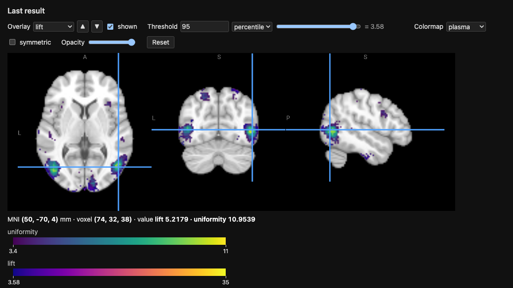

.. _tutorial-neurosynth-tests:

Neurosynth's Association and Uniformity Tests as Probability Ratios
===================================================================

Neurosynth [yarkoni2011]_ maps each term with two tests on the counts of
studies activating each voxel:

- the *uniformity test* (formerly "forward inference"): is the
  proportion of the studies of the term activating the voxel different
  from its average over the brain?
- the *association test* (formerly "reverse inference"): are the term and
  the activation of the voxel independent?  The map comes with the
  posterior probability of the term given the activation, for a uniform
  prior of 0.5.

Both are :math:`\chi^2` tests, and both reduce to a ratio of probabilities
which is 1 when there is no effect.  With ``selected_study`` the uniform
choice over the :math:`N` studies of the ``neurosynth`` engine, every
probability of a query is a count of studies divided by :math:`N`, so
these ratios are queries of the engine.

The ratios
----------

Let :math:`T` be the event that the selected study has the term and
:math:`A_v` that it activates the voxel :math:`v`.

**Association.**  :math:`T` and :math:`A_v` are independent if and only
if the *lift*

.. math::

   L_v = \frac{P(A_v \mid T)}{P(A_v)} = \frac{P(T \mid A_v)}{P(T)}
       = \frac{P(A_v \land T)}{P(A_v)\, P(T)}

is 1, and the :math:`\chi^2` statistic of the test is :math:`N` times the
squared distance of the lift to 1:

.. math::

   \chi^2_\text{association} = N\, (L_v - 1)^2\,
       \frac{P(A_v)\, P(T)}{P(\lnot A_v)\, P(\lnot T)}.

The *relative risk* :math:`RR_v = P(A_v \mid T) / P(A_v \mid \lnot T)` is
also 1 under independence, and Neurosynth's posterior for a prior of 0.5
is :math:`RR_v / (1 + RR_v)`.

**Uniformity.**  The average over the :math:`M` voxels of the mask of
:math:`P(A_v \mid T)` is itself a probability: with ``selected_voxel`` a
uniform choice over the voxels and :math:`V` the voxel it selects, it is
:math:`\bar p = P(A_V \mid T)`, the probability that the selected study
activates the selected voxel, given the term.  The ratio

.. math::

   U_v = \frac{P(A_v \mid T)}{P(A_V \mid T)} = M\, P(V = v \mid A_V, T)

is 1 under uniformity, and, with :math:`N\, P(T)` the number of studies
of the term,

.. math::

   \chi^2_\text{uniformity} = N\, P(T)\, (U_v - 1)^2\,
       \frac{\bar p}{1 - \bar p}.

Predefined in the engines
-------------------------

The ``neurosynth`` and ``neurostore`` engines define these ratios for any
term, so that a query is one line, with the term as a constant (the engine then
computes the rules for it only)::

    ans(i, j, k, uniformity) :- uniformity('working memory', i, j, k, uniformity)
    ans(i, j, k, lift) :- lift('vision', i, j, k, lift)
    ans(i, j, k, lift, relative_risk, uniformity) :-
        ratios('pain', i, j, k, lift, relative_risk, uniformity)

``lift``, ``relative_risk``, ``uniformity`` and ``ratios`` are the quantities
of the previous section, as predicates ``(term, voxel, ratio…)``, and they are
listed by ``--list-predicates``.  Their definitions are the rules of the
next section, with three differences: a term is in a study when its TF-IDF is
above 0.001 (``term_in_study``), a study activates the voxels of the whole
brain within 6 mm of its peaks (``activated``; ``brain_mask``), and the
average of the uniformity test is over the brain rather than over
``cortical_mask``, so that the subcortical structures, the cerebellum and
the hippocampus are in the map; ``selected_voxel`` is the uniform choice over
the voxels of the brain.  The maps of *working memory* take about ten seconds
for the uniformity ratio and half a minute for the three ratios on the 2 mm
grid.  In the ``neurostore`` engine the terms are those of
:ref:`its TF-IDF <tutorial-cognitive-atlas>`.  A probabilistic query needs
the term as a constant: without one the rules cannot be rewritten for it.

Free-text queries
-----------------

The same ratios exist for a free text instead of a term, with the suffix
``_llm``: ``uniformity_llm``, ``lift_llm``, ``relative_risk_llm`` and
``ratios_llm``.  The studies of the "term" are then the 5% of the studies
closest to the text, by the cosine similarity of the SPECTER2 embeddings of
their title and abstract to the text (see :doc:`tutorial_text_embeddings`)::

    ans(i, j, k, u) :- uniformity_llm('cortical response to noxious heat applied to the skin', i, j, k, u)

``study_similarity(text, study, similarity)`` gives the similarity of every
study with a text, and ``similar_study(text, study)`` the studies of the top
5%, which one can use in rules of one's own.  As for a term, the text is a
constant of the query.  Neither it nor the predicates can be computed for
every text, so they are left out of ``solve_all``.  The first query embeds the
abstracts (the model, about 430 MB, and the embeddings are cached; see
:doc:`tutorial_text_embeddings` to compute them ahead of time) and needs
``pip install "neurolang[embeddings]"``.

SPECTER2 is for descriptions that do not contain the term: for a keyword,
its TF-IDF, that is ``uniformity('pain', ...)``, is the better selection.  On
36 Neurosynth terms described by three sentences that contain neither the
term nor its variants, the map of the studies close to the text identified the
term among the 36 first in about a third of the cases, against a fifth for the
TF-IDF of the same sentence.

In the REPL
-----------

Neurosynth works on the 2 mm MNI grid, a study activating the voxels
within 6 mm of its peaks, and a term being in the studies with a TF-IDF
above 0.001.  Start the REPL of the ``neurosynth`` engine on the 2 mm
grid::

    python -m neurolang.utils.cli -e neurosynth -d neurolang_data -r 2 -i

and paste this block at the prompt.  It computes the lift and the
uniformity ratio of the term ``vision`` over the voxels of
``cortical_mask``, shows the five voxels of the largest uniformity
ratios, and opens both maps in the viewer.  Each line is preceded by a
``%`` comment saying what it computes, which the REPL skips.  The rules
which differ from the engine's, being over the cortex, end with
``_cortex``, as a second rule for a predicate of the engine would add to
its rules rather than replace them::

    % T, term_in_study(s, t), and P(T), p_term(t, PROB), are the engine's: the TF-IDF of the term t in the study s is above 0.001
    % A_v: the study s activates the voxel (i, j, k) of the cortex, within 3 voxels (6 mm) of one of its peaks
    activation(i, j, k, s) :- cortical_mask(i, j, k) & peak_reported(i1, j1, k1, s) & (EUCLIDEAN(i, j, k, i1, j1, k1) <= 3)
    % M: the number of voxels of the cortex
    n_voxels(count(i, j, k)) :- cortical_mask(i, j, k)
    % V: a uniform choice over the voxels of the cortex, each of probability 1 / M
    selected_voxel_cortex(i, j, k) ^ (1 / m) :- cortical_mask(i, j, k) & n_voxels(m)
    % P(A_v): the probability that the selected study activates the voxel
    p_a_cortex(i, j, k, PROB) :- activation(i, j, k, s) & selected_study(s)
    % P(A_v | T): the probability that a study with the term activates the voxel
    p_a_given_t_cortex(t, i, j, k, PROB) :- (activation(i, j, k, s) & selected_study(s)) // (term_in_study(s, t) & selected_study(s))
    % P(A_V | T): the same for the selected voxel, the average of P(A_v | T) over the cortex
    p_any_voxel_given_t_cortex(t, PROB) :- (activation(i, j, k, s) & selected_voxel_cortex(i, j, k) & selected_study(s)) // (term_in_study(s, t) & selected_study(s))
    % the lift P(A_v | T) / P(A_v), the relative risk P(A_v | T) / P(A_v | not T) and the uniformity ratio P(A_v | T) / P(A_V | T)
    ratios_cortex(t, i, j, k, lift, relative_risk, uniformity) :- p_a_given_t_cortex(t, i, j, k, pat) & p_a_cortex(i, j, k, pa) & p_term(t, pt) & p_any_voxel_given_t_cortex(t, pbar) & (lift == pat / pa) & (relative_risk == pat * (1 - pt) / (pa - pat * pt)) & (uniformity == pat / pbar)
    % sort the results by decreasing uniformity ratio
    .sort uniformity:desc
    % show the first 5 rows
    .head 5
    % the ratios of the term vision: magic sets compute the rules above for it only
    ans(i, j, k, lift, uniformity) :- ratios_cortex("vision", i, j, k, lift, relative_risk, uniformity)
    % open the lift and uniformity maps in the viewer
    .view

The REPL runs the rules as one submission, then each dot-command and the
query in turn, and prints the following; on a terminal, it opens the
viewer in the browser rather than telling to::

    defined activation/4
    defined n_voxels/1
    defined selected_voxel_cortex/3
    defined p_a_cortex/4
    defined p_a_given_t_cortex/5
    defined p_any_voxel_given_t_cortex/2
    defined ratios_cortex/7
    Running query...
    ╭────┬────┬────┬───────────────────┬────────────────────╮
    │ i  │ j  │ k  │ lift              │ uniformity         │
    ├────┼────┼────┼───────────────────┼────────────────────┤
    │ 74 │ 32 │ 38 │ 5.217901365952598 │ 10.953869296339628 │
    │ 73 │ 32 │ 36 │ 5.121273562879402 │ 10.953869296339628 │
    │ 72 │ 32 │ 37 │ 5.55224704372663  │ 10.576149665431366 │
    │ 74 │ 32 │ 37 │ 4.917084854014599 │ 10.198430034523103 │
    │ 73 │ 32 │ 38 │ 5.05757299270073  │ 10.198430034523103 │
    ╰────┴────┴────┴───────────────────┴────────────────────╯
    102691 rows · showing 1–5 · .more for next
    Query completed in 14.75 s
    Saved NIfTI image to: /var/folders/m_/9f8m55cs45g8_36d1wx67_jc0000gr/T/neurolang_view_6xbrumiu.nii.gz (102691 voxels of the 99×117×95 template grid, value: the max of 'lift' per voxel)
    Saved NIfTI image to: /var/folders/m_/9f8m55cs45g8_36d1wx67_jc0000gr/T/neurolang_view_5iz4zp45.nii.gz (102691 voxels of the 99×117×95 template grid, value: the max of 'uniformity' per voxel)
    Colormap of 'lift': one-sided, the image has no negative values (--symmetric for a symmetric one).
    Colormap of 'uniformity': one-sided, the image has no negative values (--symmetric for a symmetric one).
    Saved the viewer to: /var/folders/m_/9f8m55cs45g8_36d1wx67_jc0000gr/T/neurolang_view_r_39o2rq.html
    Open it in a browser to see the image.

The comments say what each line computes; some points need more words:

- The term is only given in the query, ``ratios_cortex("vision", ...)``:
  magic sets pass the constant ``"vision"`` to ``ratios_cortex``, then to
  ``p_term``, ``p_a_given_t_cortex``, ``p_any_voxel_given_t_cortex`` and
  ``term_in_study``, so that the probabilistic rules are only computed
  for this term.  Change it in the query to map another one; the rules
  stay defined.
- ``activation`` holds the voxels within 6 mm, 3 voxels of the grid, of a
  peak of each study, the ``EUCLIDEAN`` distance being in voxels.
- ``p_any_voxel_given_t_cortex`` is :math:`\bar p = P(A_V \mid T)`, a single
  probability per term: the selected study and the selected voxel are
  chosen independently, so it is the average over the :math:`M` voxels
  of :math:`P(A_v \mid T)`.
- ``ratios_cortex`` divides the probabilities.  The relative risk is computed
  from them, as :math:`P(A_v \mid \lnot T) = (P(A_v) - P(A_v \mid T)
  P(T)) / (1 - P(T))`, rather than with a query conditioned on
  ``~term_in_study(s, t)``, which is slower.

The voxels of the largest uniformity ratios, ``(74, 32, 38)`` and
``(73, 32, 36)`` of the grid, are at :math:`(50, -70, 4)` and
:math:`(48, -70, 0)` mm in MNI space, in the right lateral occipital
cortex (inferior division), around the motion area MT+ (V5): the
studies of vision activate them 11 times more often than the average
voxel of the cortex.

``.view`` shows each value column of the result as an overlay, here
``lift`` and ``uniformity``, each from the 95th percentile of its
values, with its colormap and colour bar; the read-out gives both values
at the cursor, here at the right lateral occipital cortex:

The ``Overlay`` list chooses the map the controls apply to, and
``shown`` hides it; ``uniformity``, drawn over ``lift``, covers it where
both pass their threshold, until ▼ draws it under ``lift``.  The voxels without a value, those that no
study of the term activates, are 0 and not drawn; ``.view --fill 1``
gives them the ratio of no effect instead.  Add ``relative_risk`` to the
head of ``ans`` for a third overlay, its infinite values being drawn as
its largest finite one.

The second row of controls sets NiiVue's display: ``View`` shows one
slice, the three slices or the 3D render, ``Layout`` lays the three
slices out in a row, a column or a grid, ``with 3D`` adding the render;
``Drag`` chooses what a drag with the right button does (contrast, pan
and zoom, measure); the crosshair, the gamma of the background, NiiVue's
own colour bars, orientation cube and ruler, the radiological
convention, the interpolation and a clip plane of the render have their
controls too.  On the views, the keys V and C cycle the views and the
clip planes.

Notes:

- The mask is that of ``cortical_mask``: the average of the uniformity
  test is over the cortex, whereas Neurosynth's is over the whole brain.
- A voxel which no study of the term activates is not in the result: its
  ratios are 0.  The relative risk is infinite at a voxel which only the
  studies of the term activate.
- The lift and the relative risk are largest at voxels which few studies
  activate, where they are the least stable: to rank the voxels as
  Neurosynth's association test does, use the mutual information of
  :ref:`the next section <neurosynth-mutual-information>`.

.. _neurosynth-mutual-information:

Ranking the voxels as Neurosynth does
-------------------------------------

Neurosynth's association map is not a map of the lift: it is the
:math:`z`-score of the :math:`\chi^2` test, kept where it passes a false
discovery rate of 0.01.  The statistic multiplies the squared distance of
the lift to 1 by :math:`N\, P(A_v)\, P(T) / (P(\lnot A_v)\, P(\lnot T))`,
which weighs down the voxels that few studies activate.  The two maps
differ most for a frequent term.  *prefrontal* is in 4,400 of the 14,371
studies, so its lift is at most :math:`1 / P(T) = 3.27`, and that maximum
is reached at :math:`(12, -104, 18)` mm, in the occipital pole, which only
2 studies activate, both of them with the term.  Neurosynth's largest
:math:`z`, 10.1, is at :math:`(42, 38, 30)` mm, in the right dorsolateral
prefrontal cortex, where 247 of the 473 studies activating the voxel have
the term: a lift of only 1.71.

The *mutual information* of :math:`T` and :math:`A_v` is the expectation
of the logarithm of the lift over the four combinations of the term and
the activation,

.. math::

   I_v = \sum_{x \in \{T, \lnot T\}} \sum_{y \in \{A_v, \lnot A_v\}}
       P(x, y) \log \frac{P(x, y)}{P(x)\, P(y)},

0 under independence, and :math:`2 N I_v` is the likelihood-ratio
statistic of the same independence test, which follows the same
:math:`\chi^2` distribution with one degree of freedom.  It is a rule over
the probabilities that the engine predefines, ``p_term``, ``p_a`` and
``p_a_given_t``, the probabilities of the four combinations being

.. math::

   P(T, A_v) = P(T)\, P(A_v \mid T), \quad
   P(T, \lnot A_v) = P(T) - P(T, A_v), \quad
   P(\lnot T, A_v) = P(A_v) - P(T, A_v), \quad
   P(\lnot T, \lnot A_v) = 1 - P(A_v) - P(T) + P(T, A_v).

The rule keeps the voxels which the term activates more often than the
other studies do, :math:`P(A_v \mid T) > P(A_v)`, as Neurosynth's
positive map does::

    mutual_information(t, i, j, k, mi) :- p_a_given_t(t, i, j, k, pat) & p_a(i, j, k, pa) & p_term(t, pt) & (pat > pa) & (mi == pt * pat * log(pat / pa) + pt * (1 - pat) * log((1 - pat) / (1 - pa)) + (pa - pt * pat) * log((pa - pt * pat) / (pa * (1 - pt))) + (1 - pa - pt + pt * pat) * log((1 - pa - pt + pt * pat) / ((1 - pa) * (1 - pt))))
    ans(i, j, k, mi) :- mutual_information("prefrontal", i, j, k, mi)

It takes about 25 seconds on the 2 mm grid.  To compare it with Neurosynth,
take the 5% of the 235,375 voxels of ``brain_mask`` with the largest
values of each map, 11,769 voxels, and measure the overlap of the two sets
with the Dice coefficient, :math:`2 |A \cap B| / (|A| + |B|)`.  For *prefrontal*, against Neurosynth's association
map (its image 4382, downloaded from
https://neurosynth.org/api/images/4382/download):

==========================================================  ======
Map ranking the voxels                                       Dice
==========================================================  ======
``mutual_information``                                       0.826
:math:`z` of the :math:`\chi^2` test, recomputed             0.824
:math:`P(A_v \mid T) - P(A_v)`                               0.707
Lift :math:`P(A_v \mid T) / P(A_v)`, or the relative risk    0.514
:math:`P(A_v \mid T)`                                        0.227
==========================================================  ======

The mutual information ranks the voxels as the :math:`z`-score does: the
:math:`z` recomputed from the same counts overlaps no more with
Neurosynth's map, so what differs comes from the data, such as how the
Talairach peaks are converted to MNI, rather than from the statistic.  The voxels of its top 5% are activated by a
median of 246 studies, against 143 for the lift's.

A probability of association can be derived from it: comparing the model
in which the term and the activation are independent with the one in
which they are not, the Bayesian information criterion approximates the
log of the Bayes factor by :math:`N I_v - \tfrac{1}{2} \log N`, so that,
for a prior of 0.5,

.. math::

   P(\text{association} \mid \text{data}) \approx
       \frac{1}{1 + \sqrt{N}\, e^{-N I_v}},

which ranks the voxels as :math:`I_v` does.

.. [yarkoni2011] T. Yarkoni, R. A. Poldrack, T. E. Nichols, D. C. Van
   Essen and T. D. Wager. Large-scale automated synthesis of human
   functional neuroimaging data. *Nature Methods* 8(8):665–670, 2011.
