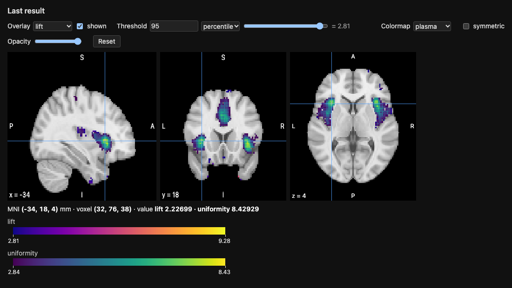

.. _tutorial-neurosynth-tests:

Neurosynth's Association and Uniformity Tests as Probability Ratios
===================================================================

Neurosynth [yarkoni2011]_ maps each term with two tests on the counts of
studies activating each voxel:

- the *uniformity test* (formerly "forward inference"): is the
  proportion of the studies of the term activating the voxel different
  from its average over the brain?
- the *association test* (formerly "reverse inference"): are the term and
  the activation of the voxel independent?  The map comes with the
  posterior probability of the term given the activation, for a uniform
  prior of 0.5.

Both are :math:`\chi^2` tests, and both reduce to a ratio of probabilities
which is 1 when there is no effect.  With ``selected_study`` the uniform
choice over the :math:`N` studies of the ``neurosynth`` engine, every
probability of a query is a count of studies divided by :math:`N`, so
these ratios are queries of the engine.

The ratios
----------

Let :math:`T` be the event that the selected study has the term and
:math:`A_v` that it activates the voxel :math:`v`.

**Association.**  :math:`T` and :math:`A_v` are independent if and only
if the *lift*

.. math::

   L_v = \frac{P(A_v \mid T)}{P(A_v)} = \frac{P(T \mid A_v)}{P(T)}
       = \frac{P(A_v \land T)}{P(A_v)\, P(T)}

is 1, and the :math:`\chi^2` statistic of the test is :math:`N` times the
squared distance of the lift to 1:

.. math::

   \chi^2_\text{association} = N\, (L_v - 1)^2\,
       \frac{P(A_v)\, P(T)}{P(\lnot A_v)\, P(\lnot T)}.

The *relative risk* :math:`RR_v = P(A_v \mid T) / P(A_v \mid \lnot T)` is
also 1 under independence, and Neurosynth's posterior for a prior of 0.5
is :math:`RR_v / (1 + RR_v)`.

**Uniformity.**  The average over the :math:`M` voxels of the mask of
:math:`P(A_v \mid T)` is itself a probability: with ``selected_voxel`` a
uniform choice over the voxels and :math:`V` the voxel it selects, it is
:math:`\bar p = P(A_V \mid T)`, the probability that the selected study
activates the selected voxel, given the term.  The ratio

.. math::

   U_v = \frac{P(A_v \mid T)}{P(A_V \mid T)} = M\, P(V = v \mid A_V, T)

is 1 under uniformity, and, with :math:`N\, P(T)` the number of studies
of the term,

.. math::

   \chi^2_\text{uniformity} = N\, P(T)\, (U_v - 1)^2\,
       \frac{\bar p}{1 - \bar p}.

In the REPL
-----------

Neurosynth works on the 2 mm MNI grid, a study activating the voxels
within 6 mm of its peaks, and a term being in the studies with a TF-IDF
above 0.001.  Start the REPL of the ``neurosynth`` engine on the 2 mm
grid::

    python -m neurolang.utils.cli -e neurosynth -d neurolang_data -r 2 -i

and paste this block at the prompt.  It computes the lift and the
uniformity ratio of the term ``pain`` over the voxels of
``cortical_mask``, shows the five voxels of the largest uniformity
ratios, and opens both maps in the viewer::

    term_of_interest('pain')
    term_in_study(s, t) :- term_in_study_tfidf(s, t, w) & (w > 0.001)
    activation(i, j, k, s) :- cortical_mask(i, j, k) & peak_reported(i1, j1, k1, s) & (EUCLIDEAN(i, j, k, i1, j1, k1) <= 3)
    n_voxels(count(i, j, k)) :- cortical_mask(i, j, k)
    selected_voxel(i, j, k) ^ (1 / m) :- cortical_mask(i, j, k) & n_voxels(m)
    p_a(i, j, k, PROB) :- activation(i, j, k, s) & selected_study(s)
    p_term(t, PROB) :- term_of_interest(t) & term_in_study(s, t) & selected_study(s)
    p_a_given_t(t, i, j, k, PROB) :- (activation(i, j, k, s) & selected_study(s)) // (term_of_interest(t) & term_in_study(s, t) & selected_study(s))
    p_any_voxel_given_t(t, PROB) :- (activation(i, j, k, s) & selected_voxel(i, j, k) & selected_study(s)) // (term_of_interest(t) & term_in_study(s, t) & selected_study(s))
    ratios(t, i, j, k, lift, relative_risk, uniformity) :- p_a_given_t(t, i, j, k, pat) & p_a(i, j, k, pa) & p_term(t, pt) & p_any_voxel_given_t(t, pbar) & (lift == pat / pa) & (relative_risk == pat * (1 - pt) / (pa - pat * pt)) & (uniformity == pat / pbar)
    .sort uniformity:desc
    .head 5
    ans(i, j, k, lift, uniformity) :- ratios(t, i, j, k, lift, relative_risk, uniformity)
    .view

The REPL runs the rules as one submission, then each dot-command and the
query in turn, and prints the following; on a terminal, it opens the
viewer in the browser rather than telling to::

    defined term_of_interest/1
    defined term_in_study/2
    defined activation/4
    defined n_voxels/1
    defined selected_voxel/3
    defined p_a/4
    defined p_term/2
    defined p_a_given_t/5
    defined p_any_voxel_given_t/2
    defined ratios/7
    Running query...
    ╭────┬────┬────┬────────────────────┬───────────────────╮
    │ i  │ j  │ k  │ lift               │ uniformity        │
    ├────┼────┼────┼────────────────────┼───────────────────┤
    │ 32 │ 76 │ 38 │ 2.226988767904886  │ 8.429294107164303 │
    │ 68 │ 77 │ 36 │ 1.8881881487320984 │ 8.124620826182461 │
    │ 68 │ 78 │ 35 │ 1.6834056926626453 │ 8.02306306585518  │
    │ 68 │ 78 │ 36 │ 1.7016328231323106 │ 8.02306306585518  │
    │ 32 │ 78 │ 36 │ 1.5440078879368966 │ 8.02306306585518  │
    ╰────┴────┴────┴────────────────────┴───────────────────╯
    128248 rows · showing 1–5 · .more for next
    Query completed in 13.67 s
    Saved NIfTI image to: /var/folders/m_/9f8m55cs45g8_36d1wx67_jc0000gr/T/neurolang_view_iqj9l527.nii.gz (128248 voxels of the 99×117×95 template grid, value: the max of 'lift' per voxel)
    Saved NIfTI image to: /var/folders/m_/9f8m55cs45g8_36d1wx67_jc0000gr/T/neurolang_view_iiwq4x8r.nii.gz (128248 voxels of the 99×117×95 template grid, value: the max of 'uniformity' per voxel)
    Colormap of 'lift': one-sided, the image has no negative values (--symmetric for a symmetric one).
    Colormap of 'uniformity': one-sided, the image has no negative values (--symmetric for a symmetric one).
    Saved the viewer to: /var/folders/m_/9f8m55cs45g8_36d1wx67_jc0000gr/T/neurolang_view_k39mctvq.html
    Open it in a browser to see the image.

The rules, in order:

- ``term_of_interest`` names the term.  It is joined in the probabilistic
  rules, so that they are only computed for this term; change it to map
  another one.
- ``activation`` holds the voxels within 6 mm, 3 voxels of the grid, of a
  peak of each study, the ``EUCLIDEAN`` distance being in voxels.
- ``selected_voxel`` is a uniform choice over the voxels of the mask,
  each of probability :math:`1/M`.
- ``p_a``, ``p_term`` and ``p_a_given_t`` are :math:`P(A_v)`, :math:`P(T)`
  and :math:`P(A_v \mid T)`; ``p_any_voxel_given_t`` is
  :math:`\bar p = P(A_V \mid T)`, a single probability per term.
- ``ratios`` divides them.  The relative risk is computed from these
  probabilities, as :math:`P(A_v \mid \lnot T) = (P(A_v) - P(A_v \mid T)
  P(T)) / (1 - P(T))`, rather than with a query conditioned on
  ``~term_in_study(s, t)``, which is slower.

The voxels of the largest uniformity ratios, ``(32, 76, 38)`` and
``(68, 77, 36)`` of the grid, are at :math:`(-34, 18, 4)` and
:math:`(38, 20, 0)` mm in MNI space, in the left and right anterior
insula: the studies of pain activate them 8 times more often than the
average voxel of the cortex.

``.view`` shows each value column of the result as an overlay, here
``lift`` and ``uniformity``, each from the 95th percentile of its
values, with its colormap and colour bar; the read-out gives both values
at the cursor, here at the left anterior insula:

The ``Overlay`` list chooses the map the controls apply to, and
``shown`` hides it; ``uniformity``, drawn over ``lift``, covers it where
both pass their threshold.  The voxels without a value, those that no
study of the term activates, are 0 and not drawn; ``.view --fill 1``
gives them the ratio of no effect instead.  Add ``relative_risk`` to the
head of ``ans`` for a third overlay, its infinite values being drawn as
its largest finite one.

Notes:

- The mask is that of ``cortical_mask``: the average of the uniformity
  test is over the cortex, whereas Neurosynth's is over the whole brain.
- A voxel which no study of the term activates is not in the result: its
  ratios are 0.  The relative risk is infinite at a voxel which only the
  studies of the term activate.
- The lift and the relative risk are largest at voxels which few studies
  activate, where they are the least stable: weigh them with
  :math:`P(A_v)`, or with the :math:`\chi^2` statistic above.

.. [yarkoni2011] T. Yarkoni, R. A. Poldrack, T. E. Nichols, D. C. Van
   Essen and T. D. Wager. Large-scale automated synthesis of human
   functional neuroimaging data. *Nature Methods* 8(8):665–670, 2011.
